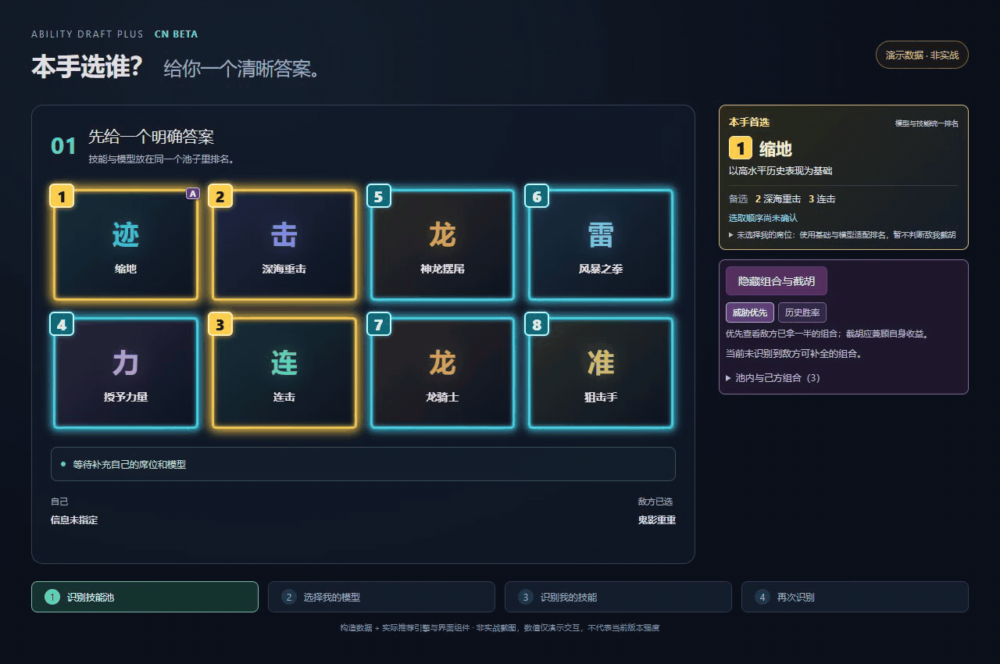

# Ability Draft Plus CN Beta

**A clear next-pick recommendation for Dota 2 Ability Draft.** Rank hero models and abilities together, update advice using your model, drafted abilities, draft seat and in-game role, and spot enemy combinations worth denying.

[简体中文](README.md) · [Download Beta](https://github.com/rubickguo/ability-draft-plus/releases/tag/v3.2.1-beta.1) · [Report an issue](https://github.com/rubickguo/ability-draft-plus/issues) · [Upstream](https://github.com/Tiarin-Hino/ability-draft-plus)

This is a community fork of **Tiarin Hino's Ability Draft Plus**, built on the original recognition and overlay system. It focuses on Chinese terminology and a single, understandable recommendation ranking. It is not an official release from Valve, Windrun or the original author. The new recommendation explanations currently prioritize Simplified Chinese; this English page does not imply full English coverage of the fork's new UI.

## Demo



**Synthetic data and schematic ability cards, using the actual ranking engine and React components. This is not a gameplay recording. The displayed statistics do not describe the current patch.** No player names or personal match records are included. [Still image](docs/media/recommendation-demo.png) · [WebM video](docs/media/recommendation-demo.webm)

## What changed

- **One explicit answer:** the best-pick card, two alternatives, explanation and numbered badges share one recommendation result.
- **One pool:** models and abilities use a single ranking. Gold highlights the top three; cyan marks ranks 4–10. Older independent priority highlights have been removed to avoid conflicting signals.
- **Contextual updates:** changing your seat, model or role recalculates advice. Rescanning removes drafted options and respects model, ultimate and basic-ability slot limits.
- **Actionable combo information:** enemy half-completed combinations remain visible. The panel identifies the owned and missing pieces, reports sample sizes and distinguishes actionable denial from speculative routes. It can be hidden or switched to historical win-rate order.
- **Chinese names:** skills and models use Dota 2 Simplified Chinese names while preserving internal identifiers for recognition and data joins.

## Download and first use

The target release is **3.2.1-beta.1**, for Windows x64. Use [this fork's release page](https://github.com/rubickguo/ability-draft-plus/releases/tag/v3.2.1-beta.1), rather than the upstream installer.

> **The packaged app starts successfully with a fresh profile; type checks, 1,125 unit tests and 2 end-to-end tests passed.** The installer has not been exercised through an actual installation. Release executables are unsigned, so Windows may report an unknown publisher. Online refresh depends on network access and source-site verification; success on every network is not promised.

This fork uses its own `%APPDATA%\ability-draft-plus-cn-beta` settings/data directory and this repository's update channel.

A **2026-10-10 public Windrun statistics snapshot for patch 7.41f** is included: 513 abilities, 127 models, 5,434 ability pairs and 3,820 model/ability pairs. The seed database contains no personal matches, account settings or private API credentials. Triplets and role-shift statistics are not bundled and require a successful online refresh. The snapshot works offline but is not automatically current-patch data.

1. Launch the app; the initial language is Simplified Chinese. Check the statistics date, use the bundled snapshot if needed, and activate the overlay.
2. When the Ability Draft board has fully loaded, press `Ctrl+Shift+S` for the initial scan.
3. Select **My Spot / 我的席位**: your player row on either side of the board. This identifies your picks and team; it is not your in-game role.
4. Set **My Model / 我的模型** when known. Optionally choose the **几号位** control for your in-game position 1–5 preference.
5. Start with the best-pick card and badge `1`. Hover for reasoning; use the combination panel to inspect enemy threats.
6. Press `Ctrl+Shift+R` after options are drafted. The next recommendation and remaining ranks update together.

Hotkeys are active only while the overlay is open. Rescan or calibrate if recognition is incomplete. The app advises; you make the pick in the game.

## Refreshing online data

1. Open the Data page and click **Update Windrun Data**.
2. If the site requests verification, the app opens a Windrun verification window. Complete the site's checks yourself.
3. Keep that window open, return to the app, and click **Retry data update after verification** (「已完成验证，重试更新」). If the window was closed, reopen it, complete any required check, then retry.
4. A failed refresh leaves existing statistics available. Check the data date before relying on the snapshot for the current patch.

**This manual recovery path has not yet been verified end to end against a real human-verification challenge.** Availability on every network, in every region or under every source-site restriction is not guaranteed. The app does not bypass or solve verification on your behalf.

The public package contains no credentials for the original author's private services. Features that depend on those private endpoints may be unavailable; the complete upstream online feature set is not promised in this Beta.

## How recommendations work

Historical performance and combination statistics come from [Windrun.io](https://windrun.io/). The fork uses an **experimental, explainable heuristic index**:

1. Start from high-skill performance, shrinking toward overall results when a known sample is small and falling back conservatively when data is missing.
2. Apply bounded, sample-adjusted combination effects for your model and owned skills, then consider role preferences, missing control, attack-type conflicts, mana demand and skill-point pressure.
3. Use seat and turn information when reliable. Confirmed consecutive picks can be compared as legal two-item plans.
4. Let denial change the first recommendation only within a near-optimal group for your own build, with sufficient evidence of an enemy threat. Unknown sample sizes or turn state produce information rather than forced denial.

**The index is not a match-win probability or a proven global optimum.** Historical combination win rate is not a causal gain for your build. Average pick order does not give an accurate survival probability. Weights and policies require feedback and validation; no win-rate improvement is promised. [Scoring implementation](src/core/domain/contextual-ranking.ts)

## Beta limitations and feedback

- Freshness depends on the source and a successful update. A bundled snapshot is not automatically current-patch data.
- Recognition and every innate, facet, talent or special interaction are not guaranteed. Incorrect inputs can affect filtering and recommendations.
- Opponent choices are not predicted precisely. Missing state is disclosed, and uncertain evidence is treated conservatively.
- The demo validates presentation and reranking, not match outcomes.

When [filing an issue](https://github.com/rubickguo/ability-draft-plus/issues), include the app version, resolution and display scaling, your model and drafted skills, observed recognition and expected recommendation. Redact player names in screenshots. Do not publish personal databases, access tokens or complete private logs.

## Development

Electron, React, TypeScript and ONNX Runtime. Node.js 22 is recommended; on Windows:

```sh
git clone https://github.com/rubickguo/ability-draft-plus.git
cd ability-draft-plus
npm ci
npm run typecheck
npm test
npm run build:beta
```

This installs locked dependencies, checks types, runs tests, and packages through the **public build path**, with output under `dist/`. `build:beta` invokes `build:public`, clearing optional private-service configuration instead of carrying local `.env` credentials into the public package. Do not substitute the ordinary `build:dist` command for a public release.

Use `npm run dev` for local development. A successful source build does not establish access to an external data API.

The [preserved upstream README](docs/UPSTREAM_README.md) documents the original project, including its download links, interface and update behavior. [Architecture](docs/ARCHITECTURE.md) · [Demo generator](scripts/create-public-demo.mjs)

## Credits and license

- Original project: [Tiarin-Hino/ability-draft-plus](https://github.com/Tiarin-Hino/ability-draft-plus), by **Tiarin Hino**. Original copyright notice retained.
- Upstream Simplified Chinese contribution: [hahahaha123567](https://github.com/hahahaha123567).
- Fork maintainer: [rubickguo](https://github.com/rubickguo).
- Statistics: [Windrun.io](https://windrun.io/). This fork's ranking policy is not Windrun's official recommendation algorithm.
- Dota 2 and related names belong to Valve. This project is not affiliated with Valve.

The isolated own-pick ownership fix has been submitted upstream as [PR #143](https://github.com/Tiarin-Hino/ability-draft-plus/pull/143).

The software is licensed under the [ISC License](LICENSE). Data, game names and associated assets remain subject to their respective owners' rights.
